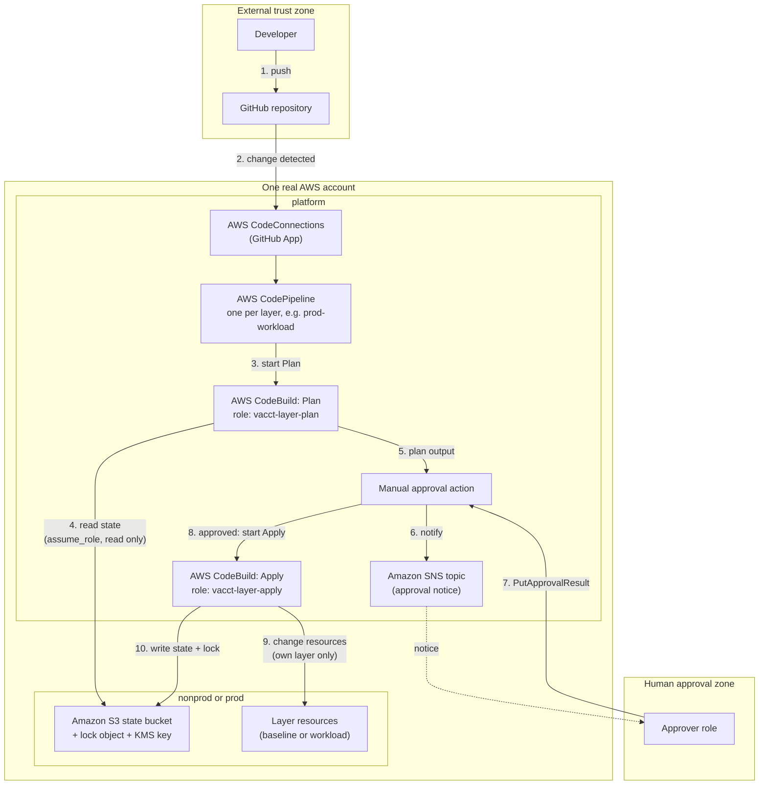

# Terraform Execution Platform for a 60-Account AWS Estate

**Cloud: Amazon Web Services (AWS).** **IaC tool: Terraform.** Every section uses AWS and Terraform. No other provider is used.

> Items marked **unverified** have not been checked against the docs.

## In short

The company has a messy infrastructure-as-code estate. This repo shows how to fix it:

1. **Split state into small pieces.** Each piece has its own state and its own lock.
   *Like a building with many small rooms, each with its own key. A problem in one room does not lock everyone out.*
2. **One pipeline for every change.** Plan, then approval by another person, then apply.
   *Like a bank cheque: one person writes it, another person signs it, and the bank keeps a record.*
3. **Shared modules with versions and tests.** No copies.
   *Like one recipe book used by every kitchen. Each new edition is tested first, and a kitchen says which edition it uses.*
4. **Move over in small waves,** and always keep a way back.
   *Like moving house one room at a time, and keeping the old keys until the new home is safe.*

## Scenario

A company has 60 AWS accounts and hundreds of Terraform repos (the scenario's wording). Modules were copied and changed (forked). Provider upgrades are risky. Nobody is sure who owns which state. Two applies can clash. App teams ask the central platform group to make every change.

## Constraints

- Central engineering owns platform standards. Product teams own their workload changes.
- Production needs separation of duties and evidence.
- The platform allows controlled module changes and account vending.
- No single global state. No single role that can do everything.
- Use AWS services, and explain how they behave and what the trade-offs are.

## Architecture diagram (mandatory)

Who talks to whom, in what order, and where the trust boundaries are. The second diagram (state, identity and failure domains), the reading notes and the list of security controls are in [docs/diagrams/architecture.md](docs/diagrams/architecture.md).



## Where each required deliverable is

| Required deliverable | Where |
|---|---|
| Platform architecture | [docs/01](docs/01-platform-architecture.md) (accounts, state, identity, network, runners, secrets, logs, recovery, account vending) |
| State/identity matrix | [docs/01, section 1.3](docs/01-platform-architecture.md#stateidentity-matrix) |
| Module standard and sample tests | [docs/02](docs/02-module-product-model.md), [`modules/secure-state-bucket`](modules/secure-state-bucket/), [`modules/layer-roles`](modules/layer-roles/) |
| Policy examples | [docs/03](docs/03-governance.md), [`policies/`](policies/), with tests in [`policies/checks`](policies/checks/) and an exception register with tests in [`policies/exceptions`](policies/exceptions/) |
| Migration runbook | [docs/04](docs/04-migration.md), with runnable demos in [`examples/migration-demo`](examples/migration-demo/) and [`examples/fork-migration-demo`](examples/fork-migration-demo/) |
| Failure runbook | [docs/05](docs/05-failure-scenario.md) |
| Operating metrics | [docs/06](docs/06-scale-and-metrics.md) |
| Mandatory architecture diagram | Above, and [docs/diagrams/architecture.md](docs/diagrams/architecture.md) |

## Key decisions and trade-offs

| Decision | Why | What we give up (where it is explained) |
|---|---|---|
| AWS and Terraform | The scenario names AWS services and Terraform repos. Provider-native services: CodePipeline, CodeBuild, S3, KMS, IAM | Less portable to another cloud (docs/01) |
| Design: one real AWS account per environment, as in the 60-account estate. Demo: three virtual accounts (`platform`, `nonprod`, `prod`) inside one AWS account | The design follows AWS account guidance. The demo shows the same layout with separate state buckets, KMS keys and IAM roles, because only one account is available | The demo has no real account wall. SCP effect, OU placement and bills per account are design only (A-01, docs/01 1.1) |
| Four layers: `org`, `baseline`, `platform`, `workload` | Risky, rarely changed layers are kept apart from team-owned ones. Teams change only `workload` | More states and pipelines to run (docs/01 1.2) |
| One state bucket per virtual account, one key per stack, S3 `use_lockfile`, no DynamoDB | No global state. Each stack has its own lock. The S3 backend page says DynamoDB locking is deprecated | Needs Terraform 1.11 or later (docs/01 1.2) |
| A plan role and an apply role per layer, with a manual approval between | Separation of duties: the person who writes a change cannot apply it | Approval expires after 7 days. No documented way to stop a committer approving their own change. The Git connection needs a manual step in the Console (docs/01 1.3, 1.5) |
| CodeBuild without a VPC (Option B) | Saves time and NAT gateway cost | No network limit on the state bucket, and outbound traffic is not controlled. Option A is written down (docs/01 1.4) |
| Modules pinned by Git tag and tested with `mock_provider` | Upgrades are reviewed. No forks | Tests do not touch real AWS (docs/02) |
| Three policy layers: SCP, platform standards, team choices | Each layer can only narrow the one above | SCPs cannot be shown in one account. `check` blocks only warn (docs/03) |
| Migration in waves. `import` and `moved` before `state mv`. A second plan with exit code 0 is the gate | Reviewable, previewable and reversible | A plan right after an import is not clean. No scan tool chosen. S3 migration with the lock file is unverified (docs/04) |
| Account vending with AFT if Control Tower is used, otherwise AWS Organizations through the `org` layer | Follows the AWS guidance | Design only. The role created automatically in a new account is a full administrator (docs/01 1.10) |
| Failure runbook: wait first, force-unlock only through break-glass, reject replacements at approval | Avoids damaging state | Detecting replacements from the plan JSON is a design, not a tested check (docs/05) |

## How to check the code yourself

Needs Terraform 1.11 or later. No AWS account is needed.

```bash
cd modules/secure-state-bucket && terraform init -backend=false && terraform test   # 4 tests
cd ../layer-roles             && terraform init -backend=false && terraform test   # 9 tests
cd ../../policies/checks      && terraform init && terraform test                  # 8 tests
cd ../exceptions              && terraform init && terraform test                  # 9 tests
cd ../..                      && ./examples/migration-demo/run-demo.sh             # migration demo
./examples/fork-migration-demo/run-demo.sh                                         # fork replaced by central module
cd stacks/nonprod/baseline    && terraform init -backend=false && terraform validate
```

## Contents

| # | Document | Task | Weight |
|---|---|---|---|
| 1 | [Platform architecture](docs/01-platform-architecture.md) (includes account vending, 1.10) | Task 1 | 25% |
| 2 | [Module product model](docs/02-module-product-model.md) | Task 2 | 20% |
| 3 | [Governance](docs/03-governance.md) | Task 3 | 15% |
| 4 | [Migration](docs/04-migration.md) | Task 4 | 20% |
| 5 | [Failure scenario](docs/05-failure-scenario.md) | Task 5 | 10% |
| 6 | [Scale and metrics](docs/06-scale-and-metrics.md) | Task 6 | 10% |

Code and files: [`modules/`](modules/) (two sample modules and tests), [`examples/`](examples/migration-demo/) (two local migration demos), [`policies/`](policies/) (policy examples and their tests), [`stacks/`](stacks/) (example stack; not deployed yet), [`docs/diagrams/`](docs/diagrams/architecture.md) (architecture diagrams).

## Assumptions and Exclusions

### Assumptions

| ID | Assumption | Where it is explained |
|---|---|---|
| A-01 | The code we can deploy runs in one AWS account. Separate accounts are **simulated** with separate state buckets and keys, KMS keys, IAM roles and name prefixes. The design itself is for one real account per environment | docs/01, 1.1 |
| A-02 | Account vending uses AWS Control Tower and AFT if the organization already uses Control Tower. Otherwise it uses AWS Organizations through the `org` layer | docs/01, 1.10 |
| A-03 | The pipeline runs in AWS CodePipeline and AWS CodeBuild without a VPC (Option B). Option A, with a VPC, is written down as the alternative | docs/01, 1.4 |
| A-04 | The pipeline source is a GitHub repository. GitLab works with the same source action | docs/01, 1.5 |
| A-05 | The examples use the Region `ap-southeast-5` (Malaysia). We did not check that every service used is available there. For example, Git connections are not available in some Regions | docs/01, 1.5 |

### Exclusions

| ID | Not included | Where it is explained |
|---|---|---|
| X-01 | Nothing is deployed to AWS. Tests use a mock provider and the demos use local state | Validation section below |
| X-02 | The pipeline resources (CodePipeline, CodeBuild projects, approval topic) are designed but not written as code | docs/01, 1.5 |
| X-03 | SCP effect, OU placement, bills per account and account creation are design only, because one account cannot show them | docs/01, 1.1 and 1.10; docs/03, 3.1 |
| X-04 | No tool is chosen for scanning hundreds of repositories, for opening upgrade pull requests, or for checking plans against rules. Policy checks cover four rules on policy files only | docs/02, 2.8; docs/03, 3.5; docs/04, 4.1 |
| X-05 | No dashboards, alarms or target values (SLOs), because there is no baseline | docs/06 |
| X-06 | Depth is not equal across tasks. Tasks 1, 2 and 4 have the most detail and code. Tasks 3, 5 and 6 are shorter | The task documents |

## Validation Steps and Known Limits

### What we checked

| Item | Check | Result |
|---|---|---|
| `modules/secure-state-bucket` | `terraform validate` and `terraform test` (Terraform v1.17.1, mock AWS provider) | Valid. 4 tests passed, 0 failed |
| `modules/layer-roles` | `terraform validate` and `terraform test` (Terraform v1.17.1, mock AWS provider) | Valid. 9 tests passed, 0 failed. Two deliberate mistakes each made the matching test fail |
| `examples/migration-demo` | `./run-demo.sh` (Terraform v1.17.1 and v1.5.7, local backend, `terraform_data`) | `-migrate-state`, `moved` and `import` all worked on both versions. Final plan exit code `0` |
| `stacks/nonprod/baseline` | `terraform init -backend=false` and `terraform validate` (Terraform v1.17.1), as written | Valid. The stack requires Terraform 1.11 or later |
| `policies/**/*.json` | JSON syntax check | Valid JSON. We did not test what the policies do in AWS |
| `policies/exceptions` | `terraform init` and `terraform test` (Terraform v1.17.1) | 9 tests passed, 0 failed. Each broken rule made its own test fail, and `terraform plan` failed with the E4 message once `today` was past the end date |
| `examples/fork-migration-demo` | `./run-demo.sh` (Terraform v1.17.1, local backend, `terraform_data`) | Without `moved` the plan said `1 to add, 1 to destroy`. With `moved` it said `0 to add, 0 to change, 0 to destroy`. Final exit code `0` |
| `policies/checks` | `terraform init` and `terraform test` (Terraform v1.17.1) | 8 tests passed, 0 failed. Breaking a real policy file on purpose made the matching test fail with the rule message |
| `docs/diagrams/architecture.md` | Mermaid parser (`mermaid.parse`) | Both diagrams parse and render in Chrome (Mermaid 10.9.1 from cdnjs). Diagram 1 was too wide to read, so it was redrawn top to bottom. In the render, a few arrows cross the box titles |

### What we did not check

- Nothing is deployed to AWS. Every "Designed" statement is design, backed by the docs listed under Sources.
- SCPs, cross-account behavior, bills per account and AFT cannot be shown in one AWS account.
- Some behaviors are still marked **unverified** inside the documents: whether `terraform plan` needs `s3:PutObject` on the state object, how `-migrate-state` treats the lock object with S3, whether the lock ID is printed in the S3 lock error, what a failed apply at the AWS API does to state (only a failed provisioner was tested, locally), the default network access of CodeBuild, and the full permission set of the `org` role. The SCP action names and bucket ARN format, and the plan JSON `actions` field, were confirmed (see docs 03 and 05).

### Known limits of this submission

- One AWS account only. Virtual accounts are split by IAM roles, state buckets and KMS keys, not by an account wall.
- No network limit on state (no VPC). Protection is identity, encryption and audit (`docs/01`, 1.4).
- A Git connection starts as `PENDING`. It must be finished in the AWS Console (`docs/01`, 1.5).
- We found no documented way to stop a committer from approving their own change. Our backup control is identity separation.
- Versions: the stack needs Terraform 1.11 or later (`use_lockfile`), and the modules need 1.7 or later (`mock_provider`). Tests ran on Terraform v1.17.1, first with a downloaded binary and again with the v1.17.1 installed on the author's machine.

## Sources and AI Disclosure

### Sources

The full list of AWS and Terraform pages (83 rows, with the syntax used from each) is in [SOURCES.md](SOURCES.md).

### AI Assistance

- Tool: Claude Code (Anthropic).
- Used for: reading the assessment e-mail; reading and summarizing AWS and Terraform docs (every page used is listed under Sources); drafting the documents in `docs/`; drafting the sample module, tests, example stack, policy examples and Mermaid diagrams; running `terraform validate`, `terraform test` and JSON and Mermaid syntax checks.
- Claims that could not be confirmed from the docs are marked **unverified** in the documents. They are not stated as fact.
