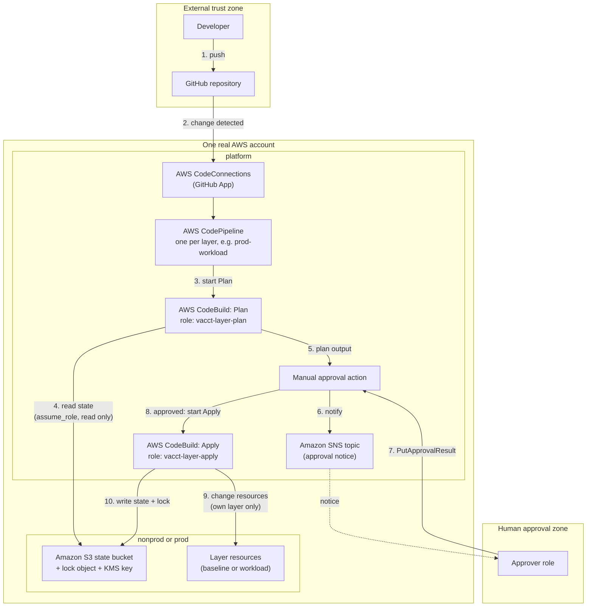
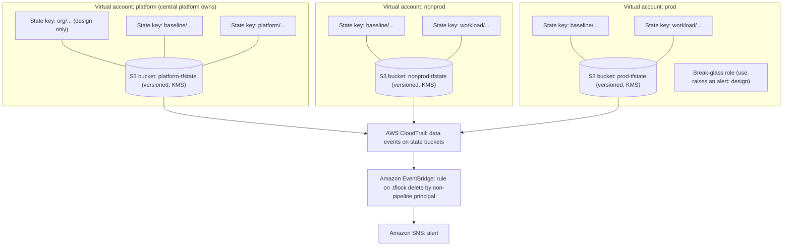

# Architecture Diagrams

**Cloud: AWS. IaC: Terraform.** Matches sections 1.1, 1.2, 1.3 and 1.5 of [01-platform-architecture.md](../01-platform-architecture.md). Secrets (1.6) are **not drawn**. Network access (1.4) uses no VPC (Option B), so there are no network parts to draw.

The diagrams use Mermaid, which GitHub shows directly. Names match the documents: virtual accounts `platform`, `nonprod`, `prod`; layers `org`, `baseline`, `platform`, `workload`; roles `<virtual-account>-<layer>-plan` and `<virtual-account>-<layer>-apply`.

## Diagram 1. Trust boundaries and traffic flow

Who talks to whom, in what order, and where the trust boundaries are.

### Reading notes

| Item | Meaning |
|---|---|
| Trust boundary: External | GitHub and the developer are outside AWS. The only bridge is the CodeConnections connection. It needs a manual handshake in the AWS Console (see 1.5, known limit). |
| Trust boundary: Human approval | The approver acts only through `codepipeline:PutApprovalResult` on one pipeline action. The approver cannot edit the pipeline. |
| Trust boundary: virtual accounts | The inner boxes `platform` and `nonprod or prod` are virtual accounts inside one real AWS account. The split is by IAM roles, state buckets and KMS keys. It is **not** an AWS account wall. This is a limit of the one-account submission (README, assumption A-01). |
| Design clarification (confirmed by the candidate) | The pipeline resources sit in `platform`. Each Plan and Apply step works on a target virtual account through that target's own role. Sections 1.1 and 1.3 already put the pipeline in `platform` and the roles per target. This diagram makes that hub setup clear. |

## Diagram 2. State, identity and failure domains

How state and identity are split, and what each failure can hurt.

### Reading notes

| Item | Meaning |
|---|---|
| Failure domain: state key | One key is one stack with its own lock. A locked or broken key stops only that stack. |
| Failure domain: layer pipeline | One pipeline per layer per virtual account. A failed `prod-workload` run does not stop `prod-baseline`. |
| Failure domain: state bucket | One versioned bucket per virtual account. Losing or damaging `nonprod` state does not touch `prod`. S3 Versioning lets you restore an older state version. |
| Failure domain: Region | One Region (not chosen yet). A Region outage hits all virtual accounts. Cross-Region recovery is only a basic design (section 1.8). |

## Security controls shown

| Control | Where | Source (see [SOURCES.md](../../SOURCES.md)) |
|---|---|---|
| Plan role read only, Apply role limited to its own layer | CodeBuild service roles | AWS Docs, *Allow CodeBuild to interact with other AWS services* |
| Role trust bound to one CodeBuild project (`aws:SourceArn`) | CodeBuild service role trust policy | same |
| State access role separate from resource role | Backend `assume_role` | Terraform Docs, *Backend Type: s3* |
| State locking with `use_lockfile` | S3 lock object next to the state | Terraform Docs, *Backend Type: s3*; *Terraform changelog v1.10 and v1.11* |
| State encryption at rest | `encrypt = true` with `kms_key_id` | Terraform Docs, *Backend Type: s3* |
| Encrypted transport only | Bucket policy denies `s3:*` when `aws:SecureTransport` is `false` | AWS Prescriptive Guidance, *Backend best practices*, https://docs.aws.amazon.com/prescriptive-guidance/latest/terraform-aws-provider-best-practices/backend.html |
| Versioning and restore | S3 Versioning on state buckets | same |
| Audit evidence | CloudTrail data events on state buckets, scoped by advanced event selector | same |
| Detection | EventBridge rule on `.tflock` delete by a non-pipeline principal, to SNS | same |
| Production gate | Manual approval, only the approver role may approve, no response in seven days fails the action | AWS Docs, *Add a manual approval action to a stage*; *permissions reference* |

## Key service names

AWS CodePipeline, AWS CodeBuild, AWS CodeConnections, Amazon S3, AWS KMS, AWS IAM, AWS CloudTrail, Amazon EventBridge, Amazon SNS. Terraform S3 backend (`use_lockfile`, `assume_role`, `encrypt`, `kms_key_id`).

## Not drawn yet

- Network components: none, because section 1.4 selects CodeBuild without a VPC
- Secrets (section 1.6)
- Logging beyond state-bucket evidence (section 1.7)
- Cross-Region disaster recovery (section 1.8)
- `org` layer effect (SCPs): design only, not demonstrable in one account
